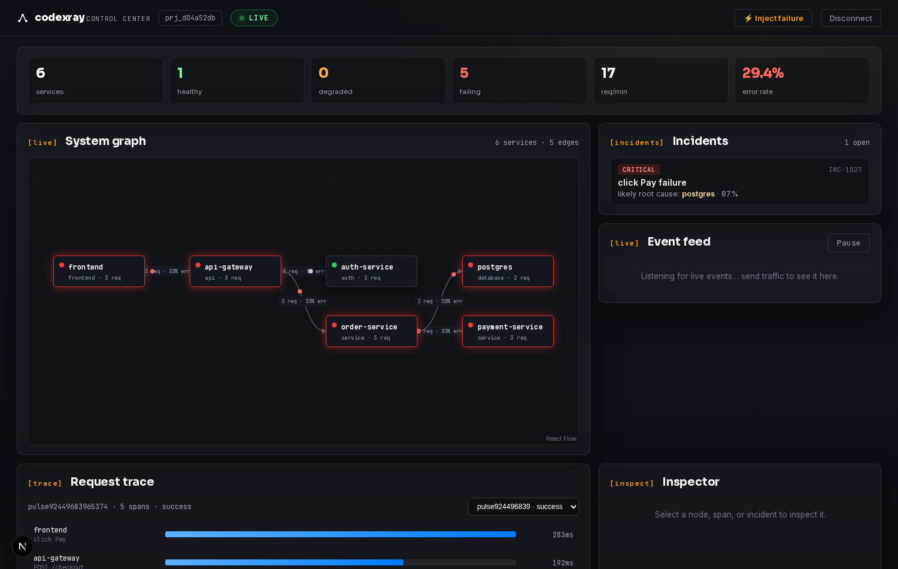

# CodeXRay

[](https://github.com/Gugilla-Aakash/codeXray/actions/workflows/ci.yml)
[](https://pypi.org/project/codexray-sdk/)
[](LICENSE)

**Watch your software think.**

CodeXRay is an open-source observability toolkit: live distributed tracing,
incident replay, and a deterministic root-cause engine — with optional
bring-your-own-key AI investigation that quotes engine evidence instead of
inventing it.



## What it does

- **Distributed tracing** — SDK spans land over HTTP, grouped into traces with
  a service dependency graph.
- **Incident replay** — step through an incident's timeline event by event,
  synced to the service graph.
- **Deterministic root-cause** — a rules engine ranks suspects and cites the
  evidence; confidence is computed, not guessed.
- **Log ingestion** — tail `*.log` / `*.jsonl` files into the dashboard's log
  panel (`codexray logs`).
- **Live stream** — a WebSocket feed pushes new traces, logs, and incidents to
  the dashboard as they happen.
- **BYOK AI investigation** — optional LLM summaries that quote engine evidence
  (`litellm`; bring your own Groq/OpenAI key). Keys are validated server-side
  and never stored in the browser.

## Architecture

```
your app (codexray-sdk / @codexray/browser)
        │  spans + logs over HTTP
        ▼
services/api ──▶ SQLite (traces, incidents, logs)
        │
        ├─ deterministic root-cause engine
        └─ WebSocket broadcast ──▶ apps/web dashboard
```

## Status

All four surfaces are in this repository: the **API**, the **Python SDK**
(on [PyPI](https://pypi.org/project/codexray-sdk/)), the **browser SDK**, and
the **Next.js app** (landing page + live dashboard).

## Quickstart

### 1. Run the API

No config needed — it falls back to a local SQLite file:

```bash
git clone https://github.com/Gugilla-Aakash/codeXray.git
cd codeXray/services/api
pip install -r requirements.txt
uvicorn app.main:app --port 3101       # docs at http://127.0.0.1:3101/docs
```

### 2. Instrument your app

```bash
pip install codexray-sdk
cd your-project
codexray init                           # creates .codexray.json
codexray serve --app app.main:app       # serve with live tracing
codexray logs path/to/app.log           # tail a log file → dashboard
codexray doctor                         # check API reachability + auth
```

`init` targets `http://127.0.0.1:3101` by default — point it elsewhere with
`--api URL` or `CODEXRAY_API=URL`. Servers with licensing disabled
(`required: false`) skip the license prompt entirely.

### 3. Open the dashboard

```bash
cd apps/web
npm ci
npm run dev                             # http://127.0.0.1:3100
                                        # console at http://127.0.0.1:3100/dashboard
```

The dashboard talks to the API at `http://127.0.0.1:3101`; override it with
`NEXT_PUBLIC_CODEXRAY_API=https://api.example.com`.

## Development

```bash
# API (FastAPI)                     93 tests
cd services/api && pip install -r requirements.txt && python -m pytest tests/ -q

# Python SDK (codexray-sdk)         34 tests
cd sdk/python && pip install -e . pytest httpx sqlalchemy && python -m pytest tests/ -q

# Browser SDK (@codexray/browser)    5 tests, zero dependencies
cd sdk/js && node test/run.mjs

# Web (Next.js)
cd apps/web && npm ci && npm run lint && npx next build --webpack
```

CI (`.github/workflows/ci.yml`) runs all three jobs on every push. The web job
builds with webpack: on Next 16.3.5 the default Turbopack build fails to resolve
the three `next/font/google` queries in `apps/web/app/layout.tsx`.

## Repository layout

```
services/api/   FastAPI backend: ingest, traces, replay, root-cause, AI
sdk/python/     codexray-sdk — CLI + tracer middleware (on PyPI)
sdk/js/         @codexray/browser — browser tracer (zero deps)
apps/web/       Next.js landing page + live dashboard
```

## SaaS licensing

Set `CODEXRAY_LICENSE_KEY` in `services/api/.env` to a comma/newline-separated
list of valid license keys. `codexray init`, `POST /api/projects`, and
`POST /api/demo/setup` then require a matching key (`X-License-Key` header;
the CLI prompts in a box). Unset = open mode, no gating.

## License

MIT
